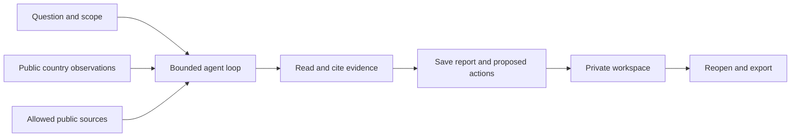

# 企业出海咨询/国区营商环境监测智能体

结合本次企业背景与问题，收集目标市场的公开资料、比较国区指标，保存研究报告与后续行动。

**开放范围与交流：** 公开版包含国区评分配方、分项权重和通用研究步骤。部分进一步的研究方法、专用提示词及相关知识内容暂未开源。如需了解这些能力、讨论使用方式或进一步交流，欢迎[联系作者](https://github.com/workstonedai-collab)。项目问题也可以通过 [Issue](https://github.com/workstonedai-collab/market-entry-agent/issues/new) 联系；涉及私人资料的内容请勿直接发布在公开 Issue。

[中文上手说明](README.zh-CN.md) · [Deployment](docs/deployment.md) · [Public country data](docs/country-dashboard.md)

# Market Entry Agent

A self-hosted research agent with a country-data dashboard, bounded source tools, resumable tasks and saved reports. Define your question and scope, configure your model endpoint, and keep evidence and outputs in your own workspace.

The country-reference calculation and general research steps are public. Some additional research methods, specialized prompts and associated knowledge resources are not open source at this time. For access inquiries or further discussion, [contact the author](https://github.com/workstonedai-collab) or open a [project issue](https://github.com/workstonedai-collab/market-entry-agent/issues/new) without posting private material.

## Run locally

```bash
python -m pip install .
market-entry-agent --workspace ./workspace demo
market-entry-agent --workspace ./workspace serve
```

Python 3.11+. The fictional demonstration and country dashboard need no model key. Model research requires an explicitly configured compatible endpoint; the model chooses among documented tools. The country tool exposes source-level public World Bank observations for 215 economies, including B-READY observations for 101. The published research reference combines source components with explicit weights and contributions. Different coverage is kept separate, and the output is not a country ranking.

Public source periods, attribution and missing values remain visible. Search sends only explicit public queries; mission context and selected evidence go to the configured model. Runtime state stays in private local workspaces. Optional `AGENT_INSTRUCTIONS_FILE` loads the operator's own instructions from outside the repository and sends them to that model. No private research knowledge service is bundled.


## Workflow



[Architecture](docs/architecture.md) · [Model/search configuration](docs/live-research.md) · [Hermes](docs/hermes.md) · [Country data](docs/country-dashboard.md) · [Evidence](docs/evidence.md) · [Public release policy](PUBLIC_RELEASE_POLICY.md).

## Verify and extend

```bash
python -m unittest discover -s tests -v
python scripts/check_public_release.py
```

The runtime uses the Python standard library. Deploy separate workspaces/processes for separate customers. The alpha provides no hosted tenant service or automatic external messages. Code is MIT; World Bank data has separate attribution and terms in [LICENSE-DATA.md](LICENSE-DATA.md).
