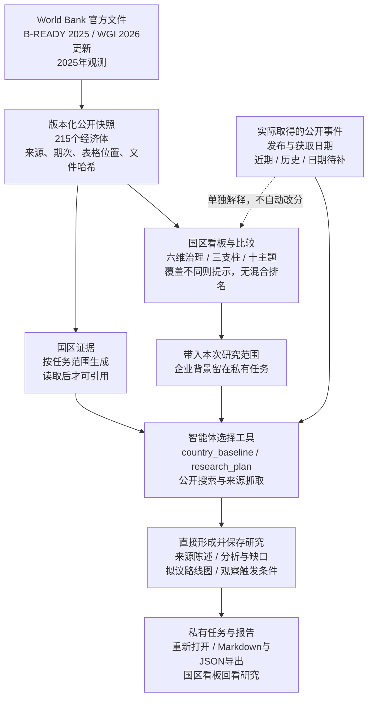
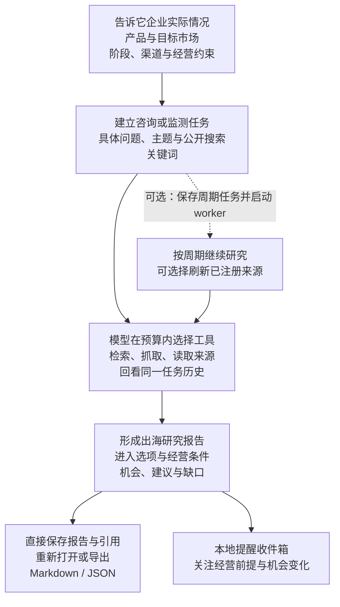
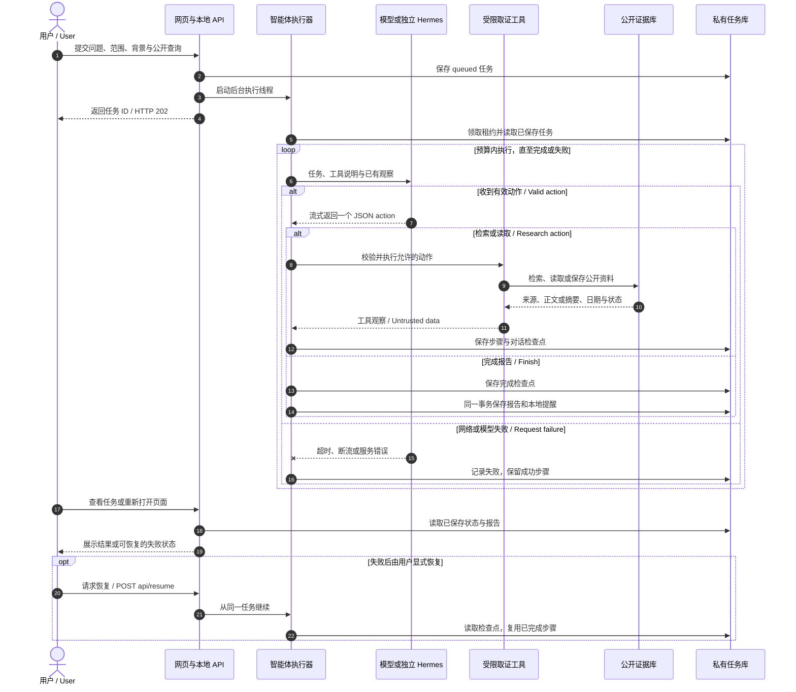
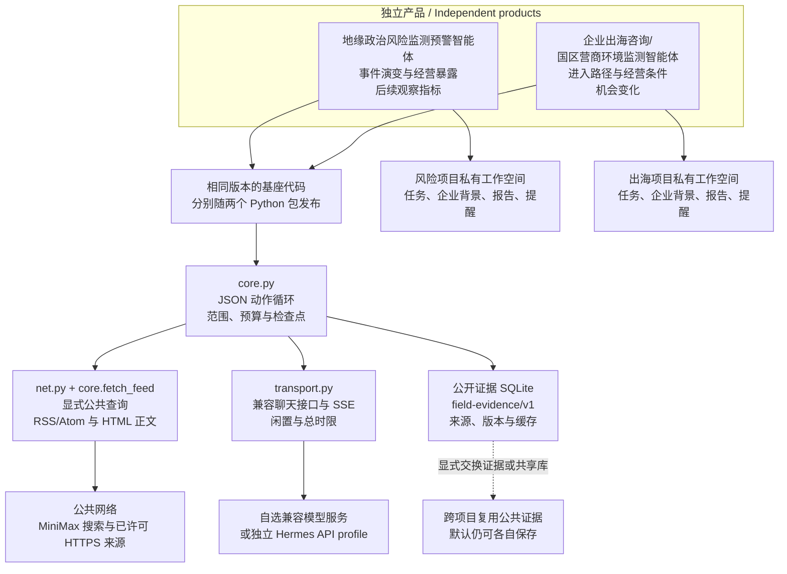

# 企业出海咨询/国区营商环境监测智能体

围绕企业真正要做的选择，比较市场与进入方式，理清交易责任、成本和经营前提，形成带来源的分析与后续验证安排。

Market Entry Agent · [English guide](#english-guide) · [中文完整说明](README.zh-CN.md) · [先跑示例](#try-it-in-two-minutes) · [正式版本 / Release](https://github.com/workstonedai-collab/market-entry-agent/releases/tag/v0.13.0)

[](https://github.com/workstonedai-collab/market-entry-agent/actions/workflows/ci.yml)
[](LICENSE)
[](pyproject.toml)
[](docs/roadmap.md)

出海前要回答的问题很多：先做哪个市场，找经销商还是自建团队，产品能否进入，售后怎么安排，政策变化会不会改变原来的成本和计划。通用国别报告往往很难回答一家企业的具体问题。相同的市场，对不同产品、客户和经营条件，可能意味着完全不同的选择。

这是一个围绕企业实际情况做出海研究、并持续跟踪目标市场变化的智能体。告诉它你卖什么、服务什么客户、打算去哪里、目前处在哪个阶段，以及预算、渠道和交付有哪些约束，它会检索公开信息，阅读相关材料，梳理进入路径、经营条件、值得验证的机会和需要补充的信息。报告尽量把判断落到准入、渠道、订单、成本与执行条件上，并交代建议成立的前提。

它面向有出海业务的企业、跨国公司高管，以及战略、风控、海外业务等相关部门，也面向咨询公司、律所和其他服务企业出海的专业机构。同一个项目里，高管可能先看选择与主要依据，业务部门更关心需要取得什么材料、哪个环节会阻断推进，顾问则需要回看分析所用的来源和条件。

## 可以这样使用

**选市场与进入方式：把选项放在企业条件下比较。** 如果一家设备企业在两个市场之间选择，可以围绕需求、准入、渠道、交付和售后逐项展开，比较经销、合作或自建能力的条件与代价。资料不足时，仍可解释什么情况下某个方案更合适，并把会改变选择的问题列出来；有了年度营商指标，也仍需结合产品和交易判断。

**交易责任与业务测算：先分清由谁承担，再看这笔业务。** 同一款产品采用两种进口安排，生产方、出口方、卖方、进口主体和客户的责任可能不同。项目可以记录这些关系，以及你提供的报价或假设，按同一币种、数量和单位比较贡献额与现金占用。未知项留空，数值保留依据，报价修改后能回看前后差异。贡献额尚未计入未列出的费用，不等于企业净利润。

**经营前提与方案跟踪：进入市场后，继续看哪些条件发生了变化。** 一项贸易安排、投资规则或当地经营政策，可能带来机会，也可能改变原来的计划。围绕已经记录的方案与假设，可以查看新资料关联了哪些选项、阶段和决策，安排接下来需要谁取得什么材料、在什么节点再作判断。是否调整选择，仍由你决定。

## 把研究接着做下去

你提供的材料可以在“我的知识库”里按项目整理：上传文件、查看解析状态，再选择本次研究使用哪些资料。原件、版本与出处留在私有工作空间，更新资料后仍能追溯旧任务。

希望持续关注时，先保存监测方案，预览并确认范围、提醒标准和检查/汇总频率，再启动工作进程。事件风险、长期议题和经营机会分别设置；没有新增内容时保持安静。需要飞书等渠道时，可显式接入已有 Hermes 发送配置。

项目还可以按你的选择积累研究经验：本地整理有效步骤与纠正，或在独立额度内让模型提炼技能候选。技能保留来源任务与版本，可以启用、停用和回退；不会自动扩大工具权限或公开你的资料。[知识库、持续监测与技能学习说明](docs/continuous-research.md)

你可以围绕一个问题跑一次研究，也可以把资料、方案和判断保存在同一个项目中接着做。来源陈述、假设、分析和操作者决定分别保留，修改有版本和原因；新的问题与输入优先。周期跟踪需要单独启动工作进程，获取新资料与本地对比是不同操作。

研究完成后，报告和来源可以重新打开，导出 Markdown、JSON，或通过可选的本地 OfficeCLI 导出可编辑 Word，继续用于内部讨论或咨询工作。已有 Word、Excel、PowerPoint 可通过可选适配器导入；本地 MCP 接口也能让自己的客户端读取已有研究。办公转换不额外调用模型，私有企业资料与公共证据分开管理。[方案与测算说明](docs/decision-paths.md) · [办公资料与任务入口](docs/office-and-tasks.md) · [研究记忆](docs/research-memory.md)

如果你不熟悉编程，可以把这个仓库交给自己的 Agent，让它按说明部署，先用演示熟悉操作，再接入模型、公开搜索和信息源。可以独立使用，也可以与[地缘政治风险监测预警智能体](https://github.com/workstonedai-collab/georisk-agent)共享公共证据。企业画像、任务和咨询报告保存在各自的私有工作空间。

**开放范围与交流：** 国区评分配方、分项权重、贡献计算与通用研究步骤已公开。部分进一步的研究方法、专用提示词和相关知识内容暂未开源。如有需要或希望进一步交流，欢迎[联系作者](https://github.com/workstonedai-collab)或提交[项目 Issue](https://github.com/workstonedai-collab/market-entry-agent/issues/new)；私人资料请勿直接发布在公开 Issue。

当前正式版本为 **v0.13.0**。可自行部署，项目仍处于 Alpha 阶段；离线演示无需模型密钥，真实研究需配置模型与来源。

<a id="english-guide"></a>

# Market Entry Agent

A research agent for the choices businesses face when entering and operating in overseas markets. Describe the product, customers, target markets, current stage and constraints. The agent reads permitted sources and connects available evidence to market access, channels, delivery, costs and execution, with explicit conditions and questions to verify.

## See the workspace


This is the country dashboard, not a completed assessment for an arbitrary business. Use the demo below to inspect saved results; [public examples](examples/README.md) explain which inputs are fictional or attributed public data.

## Try it in two minutes

Python 3.11+ required. No model key, external service or paid account is needed for the offline demonstration.

```bash
git clone https://github.com/workstonedai-collab/market-entry-agent.git
cd market-entry-agent
python3 -m venv .venv
source .venv/bin/activate
python -m pip install -e .
market-entry-agent demo
market-entry-agent serve
```

Open **http://127.0.0.1:8712**. Inspect the saved brief, source records and tool trace. Choose a mission, run it again, or export the result as Markdown/JSON.

The demo uses **fictional scenarios and a deterministic policy**. Its interface and exports are labeled accordingly. It demonstrates the execution and storage path, not the quality of an LLM or real-time intelligence.

For native Windows, use PowerShell without activation:

```powershell
py -3.11 -m venv .venv
& ".\.venv\Scripts\python.exe" -m pip install .
& ".\.venv\Scripts\python.exe" -m market_entry_agent demo
& ".\.venv\Scripts\python.exe" -m market_entry_agent serve
```

See the [Windows installation, model configuration and troubleshooting guide](docs/windows.md). CI exercises Python 3.11–3.13 on Windows, macOS and Linux, plus a clean PowerShell installation. The package is installed from this repository or its release wheel; no PyPI publication is claimed.

## Background and open scope

Build named private knowledge collections from your files, then select them for a project task. Draft and preview a watch, confirm its scope, criteria and check/digest cadence, and run a separate worker. Optional procedural learning turns completed tool paths and explicit corrections into private, versioned skills; activation and rollback remain visible. Model distillation has its own opt-in daily budget. [Setup and limits](docs/continuous-research.md).

A research agent for the choices businesses face when entering and operating in overseas markets. Describe the product, customers, target markets, current stage and constraints. The agent reads permitted sources and connects available evidence to market access, channels, delivery, costs and execution, with explicit conditions and questions to verify.

It serves businesses with overseas operations, multinational executives and teams in strategy, risk and international business, as well as consultants, legal professionals and other advisers supporting market entry. The same project can retain the basis for a management decision and the material that an operating team needs to act on it.

Choose **market and entry options** to compare markets and routes under your business conditions. Choose **transaction responsibility and economics** to distinguish the manufacturer, exporter, seller, importer and buyer, and compare operator-supplied quotes or assumptions on a consistent basis. Choose **operating-premise monitoring** to connect new material to saved assumptions, options and decisions. Missing figures remain unknown; contribution is not net profit, and the operator retains the final choice.

Keep related research in one project, retaining source statements, assumptions, judgments and decisions with their revisions. Reopen reports, inspect sources and continue unresolved questions. Optional local adapters import DOCX/XLSX/PPTX and export the complete saved report as editable Word without another model call. Recurring work requires a separately started worker, and local comparisons use saved material. [Task and Office guide](docs/office-and-tasks.md).

**Open scope and contact.** The country-reference formula, component weights, contributions and general research steps are public. Some additional research methods, specialized prompts and associated knowledge resources are not open source at this time. For further discussion, [contact the author](https://github.com/workstonedai-collab) or open a [project issue](https://github.com/workstonedai-collab/market-entry-agent/issues/new) without posting private material.

Initial drafting uses a versioned writing skill to explain the current choice, option tradeoffs, conditions and next checks. Source retrieval status is available alongside the evidence. See [report writing and case evaluation](docs/report-quality.md).

Research questions, exact source fragments and next steps can now be saved and resumed. Optional public-term search composition and local text/CSV imports extend the existing tools. PDF text extraction requires a separately configured adapter and does not include OCR; the base runtime has no added dependencies. [Research-state guide](docs/research-state.md).

Three additional historical cases can be run individually to inspect the agent’s direct output: `cbam-importer`, `cptpp-origin`, `eudr-furniture`. Inputs, returned JSON actions and raw reports are retained privately for comparison. [Case instructions](docs/report-quality.md#用几组真实事件检查直接生成的原稿).

## Continue the business project

Keep the product, buyers, capabilities and constraints alongside the markets and entry routes under consideration. Compare options across demand, access, channels, delivery, economics and risk, then record the assumptions and work each option depends on. Changed enterprise conditions flag older options for another look while preserving the original reasoning.

New matching public material prompts you to revisit a premise and shows the linked options and stages. The agent can propose a plan; you record decisions, actual progress and results. Local comparison checks saved material, so collecting new information still requires research, source refresh or a configured worker.

[Workflow guide and public replay](docs/product-workflow.md) · [Case sources](examples/public-project-case.json)

### Compare responsibility and scenario economics

Record manufacturer, exporter, seller, importer and buyer separately. Operator quotes or explicit assumptions drive single-currency calculations of contribution and cash outlay; missing inputs stay unknown. Quote revisions retain each figure’s basis and the before/after results. Premise checks are ordered by blockers, decision impact and effort, while source changes point to affected options and decisions. See [entry decision paths](docs/decision-paths.md).

## Questions to bring to the agent

| Example question | Useful context | Research output to look for |
|---|---|---|
| Which market should we investigate first: Vietnam or Indonesia? | Product, customers, entry stage, channels and delivery constraints | Comparable operating conditions, supporting evidence and demand questions to test |
| Should we use a distributor or build local service capacity? | Service requirements, intended investment, current capabilities and market | Entry options, prerequisites, proposed stages and completion signals |
| Which changes matter after entry? | Chosen entry mode, cost assumptions and topics to follow | Changes to operating assumptions, opportunities, watchpoints and sources |

These are example questions, not customer engagements or validated market choices. Try the [fictional mission](examples/mission.json) or the [public country-data mission](examples/public-data-mission.json).

## Published research steps

The public outline follows **macro conditions → industry → competitors → entry route**. Check that demand proxies, tariffs, certification, channels and market shares refer to the relevant product, place and period. `research_plan` supplies the outline. Reports can save `roadmap` stages with goals, actions, deliverables, dependencies and completion signals, and `watchpoints` for assumptions that may change. A custom mission can require either field through `output_sections`. Proposed stages do not imply existing partnerships or completed work.

## A country desk, from background to action

Explore **215 economies with governance observations**, including **101 with both B-READY and WGI**. View six governance dimensions, three business-environment pillars and ten business topics; compare up to five countries, inspect source periods and continue into a research mission. The desk also shows public evidence actually collected in the workspace and previously saved country research.

Market-entry research can cover macro conditions, industry, competitors and entry routes, then save proposed roadmap stages. Risk research can save business exposures and observable watchpoints. Both extensions persist with reports and exports. The 60% B-READY / 40% WGI synthesis is a **research reference**, with WGI-only and incomplete coverage clearly separated. No mixed-basis ranking or automatic event-driven score movement is generated.

The bundled snapshot uses B-READY 2025 and WGI 2026 Update observations for 2025, retrieved on 2026-10-21. [Country desk and method](docs/country-dashboard.md) · [Data attribution](LICENSE-DATA.md).




<a id="workflow"></a>

## Workflow and technical route

Start with a scoped question. The model chooses tools within the action and time budgets, reads the available material and saves a sourced report. These diagrams use the Chinese product names and bilingual runtime labels.



Recurring research requires a separately started worker. Reports save directly; confirming an inbox item changes only its local notification state.

<details>
<summary>Execution sequence and shared technical foundation</summary>

### Submission, research and recovery

The web API returns a task ID immediately. Research continues on the server, with each completed tool step checkpointed. You can reopen the page or explicitly resume a failed run.



The configured model receives the mission, business context and selected evidence. Public search receives only explicit public queries or combinations of operator-approved public terms. Source content is treated as data rather than instructions.

### Shared code, independent workspaces

The repositories install and release independently. They vendor the same versioned core and use the `field-evidence/v1` evidence contract. Public evidence exchange or a shared evidence database is an explicit operator choice.



The shared foundation denotes code distributed inside each package. Private missions, company context, reports and notification state stay in separate workspaces; selected material is transmitted to the configured model endpoint.

</details>

## Continue a project across research tasks

Give related missions an explicit `project_id`. Save operator-owned facts, recall related reports, load document skills on demand and inspect model-call receipts. Current task input takes precedence; private context stays in the workspace and goes only to the configured model. Public search receives only explicit queries or approved public-term combinations.

```bash
market-entry-agent memory-set fictional-research product "Synthetic equipment export case"
market-entry-agent demo --project fictional-research
market-entry-agent run examples/project-mission.json --engine demo
market-entry-agent skills
```

Model context uses a configurable character budget and saved-result references. Pause/cancel controls settle at safe boundaries; failed attempts retain completed steps and a model-call limit across resume. [Full guide: memory, context, tools, skills and recovery](docs/kernel.md). Windows uses the same commands through its venv Python.

### Continue research with typed memory

Source statements, hypotheses, judgments and proposed decisions stay distinct across runs of an explicit project. Context selection uses the current question and critical constraints, retaining relevant opposing evidence. Operators can record decisions, inspect revisions and remove memory; resumed runs retain their frozen context. Previous analysis never becomes newly read evidence. See [research memory and context](docs/research-memory.md).

## Use a model and your evidence

Set an explicit chat-completions endpoint. A dedicated [Hermes API profile](docs/hermes.md) is supported through its compatible endpoint; other compatible local or hosted models can use the same JSON-action protocol.

```bash
export AGENT_MODEL_BASE_URL=http://127.0.0.1:8642/v1
export AGENT_MODEL_NAME=dedicated-research-profile
export AGENT_MODEL_API_KEY=your-own-gateway-key

market-entry-agent --workspace ./workspace import your-evidence.json
market-entry-agent --workspace ./workspace run examples/mission.json --engine model
market-entry-agent --workspace ./workspace serve
```

Evidence can be deliberately imported or retrieved through registered sources and explicit public search queries. Model mode sends the mission, business context, retrieved evidence and summaries of earlier runs for the same mission to the configured endpoint. It does not discover local credentials or read other projects.

### Refresh public feeds

Register your permitted RSS/Atom feeds using the configuration described in [the evidence guide](docs/evidence.md), then let the model select `fetch_feed`, or refresh one explicitly:

```bash
market-entry-agent sources your-sources.json
market-entry-agent fetch your-source-id
```

The public runtime supports MiniMax public web search and bounded HTML page retrieval alongside registered feeds and local evidence search. See [live research](docs/live-research.md) for configuration and data boundaries. Country and topic tags on feeds are operator-supplied. Source claims remain claims until a human verifies them.

### Bring your own research instructions

The public package includes generic role instructions, the published research outline and report schemas. Set `AGENT_INSTRUCTIONS_FILE` to an explicit UTF-8 file outside the repository, up to 24KB, to add your own instructions. Its contents go to the configured model and persist in local checkpoints. Resuming uses the saved instructions; start a new mission to apply changes. See [model, search and data boundaries](docs/live-research.md).

## What the agent can do

| Capability | Current behavior |
|---|---|
| Model-directed research | One JSON action per turn; the model selects documented, bounded tools |
| Evidence | Content-addressed revisions, original links, claim status and two timestamps |
| Memory | Project facts, source statements, hypotheses, judgments, proposed decisions and operator decisions retain their provenance; context is selected for the current question and frozen per attempt; legacy same-mission recall remains available without a project ID |
| Recovery | Save steps and model context; retry a failed run without repeating saved steps |
| Monitoring | Confirmed event/topic/operating watches with separate check and digest cadence, meaningful-change records and recovery; a separate worker executes them |
| Delivery | Save reports immediately; export Markdown/JSON; local inbox by default, optional explicitly confirmed Hermes destination with receipts |
| Interfaces | CLI, browser workspace, loopback HTTP API, opt-in local MCP stdio adapter and container recipe |

Available tools: `country_baseline`, `research_plan`, `search_evidence`, `read_evidence`, `recall`, `list_sources`, `fetch_feed`, `web_search`, `fetch_page`, `finish`, `load_skill`, `read_result`, `project_state`. Saved-research tools add `research_state` and `update_research`; optional public-term composition adds `adaptive_search`, while research depth adds `research_branch` and `close_branch`. Tools are exposed only when their prerequisites are configured. There is no model-generated shell execution. Finding citations must reference records the agent actually read. This validates provenance, not the truth of every model statement.

## Keep a mission running

```bash
market-entry-agent schedule examples/mission.json --engine model --interval 3600
market-entry-agent worker --once
# For continuous execution, run this under your own process supervisor:
market-entry-agent worker
market-entry-agent schedules
market-entry-agent outbox
```

Creating a schedule does not start a background service. Model runs may choose to refresh registered feeds; a schedule does not force every source to refresh. New evidence revisions create a new local notification; unchanged evidence for the same mission is deduplicated. Legacy schedules remain local; new confirmed watches can opt into a separately configured Hermes destination. See [continuous research](docs/continuous-research.md). See [runtime and recovery](docs/runtime.md).

## Two agents, interoperable evidence

[georisk-agent](https://github.com/workstonedai-collab/georisk-agent) is an independent product with different research goals. Both use the versioned `field-evidence/v1` contract and identical vendored runtime code. Export/import public evidence bundles or explicitly point both at the same public evidence database. Keep company context, task history and reports in separate private workspaces. See [shared core](docs/shared-core.md).

## Self-host and develop

```bash
python -m unittest discover -s tests -v
python scripts/check_core.py
docker build -t market-entry-agent .
docker run --rm market-entry-agent demo
```

For persistent serving, authentication, workers and reverse proxy setup, see [deployment](docs/deployment.md). GitHub hosts the code and releases; it does not operate a live monitoring service for you.

## Tools and Office files

### Connect tools and choose research depth

Expose saved tasks, reports and project state through an opt-in [MCP stdio adapter](docs/mcp.md), read-only by default. Explicit startup permission enables bounded task execution. Operator-configured outbound MCP search receives public queries only. [Optional research branches](docs/research-depth.md) retain separate question paths inside the same run and budgets; document skills describe inputs, outputs and tool needs without granting permissions.

### Office files and task-focused research

Choose a task in the browser or CLI: geopolitical topic research, event/reporting preparation or interest monitoring; market options, transaction review or operating-premise monitoring. Optional MarkItDown imports local DOCX/XLSX/PPTX, while a local iOfficeAI/OfficeCLI adapter exports the complete saved report as editable DOCX without another model call. [Setup and boundaries](docs/office-and-tasks.md) · [Integration references](docs/integration-references.md).

## Scope and next steps

This is a **single-operator, self-hosted alpha**. Current limitations: no hosted tenant system, default external messaging, guaranteed event coverage, calibrated forecasts, commercial country index or autonomous transaction execution. Automated contract tests cover recovery, citations, search boundaries and streaming failures. See the [roadmap](docs/roadmap.md) and [security boundaries](SECURITY.md).

Code is MIT licensed. World Bank observations retain their own attribution and terms in [LICENSE-DATA.md](LICENSE-DATA.md). Contributions with reproducible public or synthetic examples are welcome.


## Release and evaluation history

[当前正式版本 v0.13.0](https://github.com/workstonedai-collab/market-entry-agent/releases/tag/v0.13.0) · [完整更新记录](RELEASE_NOTES.md) · [报告案例与实际限制](docs/report-quality.md)

<details>
<summary>Earlier v0.11.0 product paths and evaluation</summary>

## v0.11.0: compare the transaction, then choose what to verify first

The [release and installation packages](https://github.com/workstonedai-collab/market-entry-agent/releases/tag/v0.11.0) are available. Keep transaction responsibilities, quotes and key premises in one project, then track which new sources may affect the choice.

For two import arrangements, record the manufacturer, exporter, seller, importer and buyer separately, with quotes or explicit assumptions. The project compares contribution and cash outlay on the same currency, quantity and unit basis. Missing inputs stay unknown; figures retain their basis, and quote revisions show what changed. Contribution excludes unlisted costs and is not net profit. Tax rates and responsibilities require operator input. See [entry decision paths](docs/decision-paths.md).

Record which premises block progress, how much they affect the choice and who needs to obtain which material. New sources point to related options, stages and decisions; you decide whether to change course. Follow-up research keeps source statements, hypotheses, judgments and proposed decisions separate, selecting relevant material and opposing evidence for the current question while retaining your decision history. [Research memory](docs/research-memory.md) · [Saved research state](docs/research-state.md)

An optional [local MCP adapter](docs/mcp.md) lets your client read saved work; task creation and recovery require explicit startup permission. [Question branches](docs/research-depth.md) can examine matters such as rule applicability and transaction costs within the same task and budgets. Public search uses only approved queries or term combinations, without adding private business context.

This version was exercised with MiniMax on historical CBAM material and two fictional transaction paths, including quote edits, recalculation, revisions and report reopening. The original report retains one cost-difference wording error, which can be checked against the calculation table. See [case results, save recovery and limits](docs/report-quality.md#v0110-产品路径验收).

</details>
