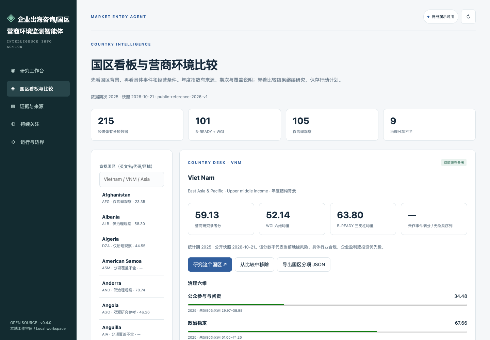
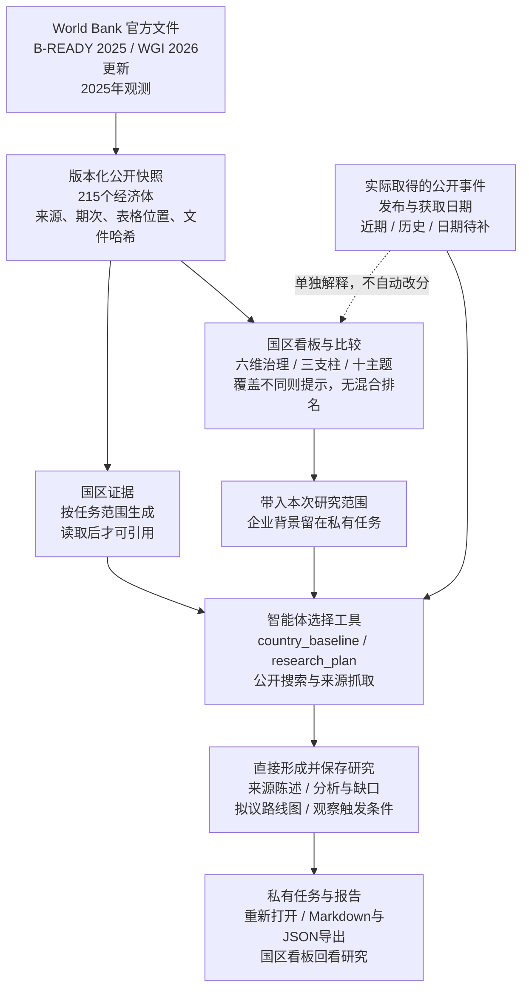
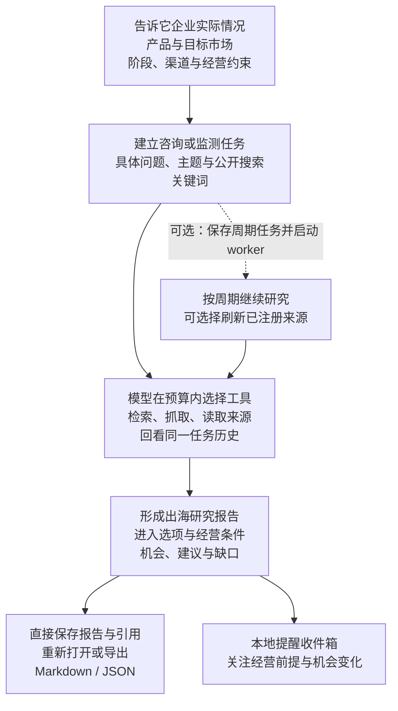
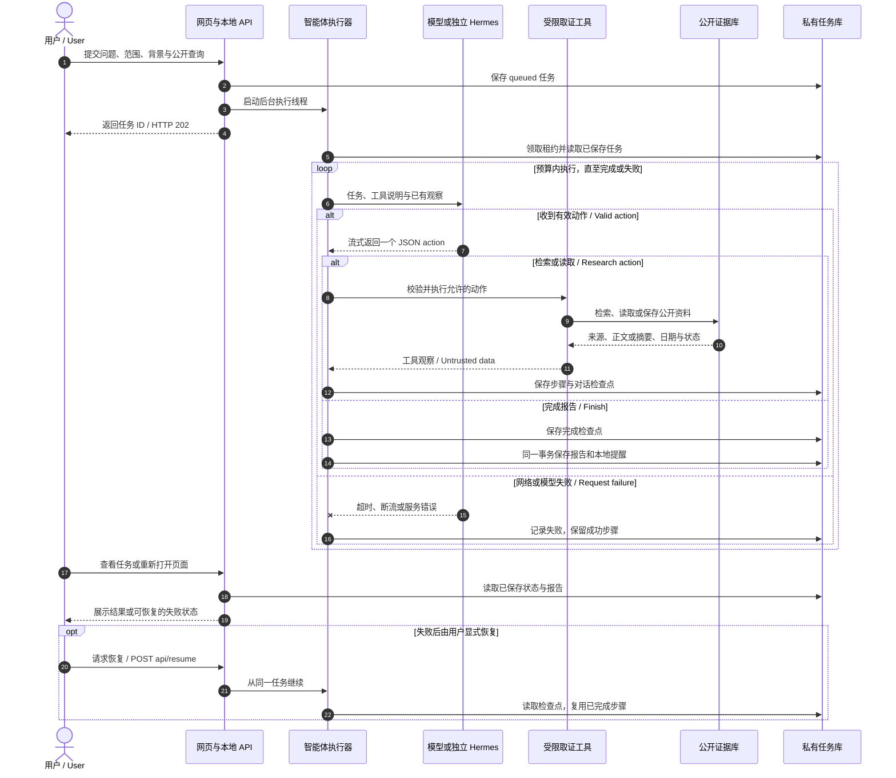
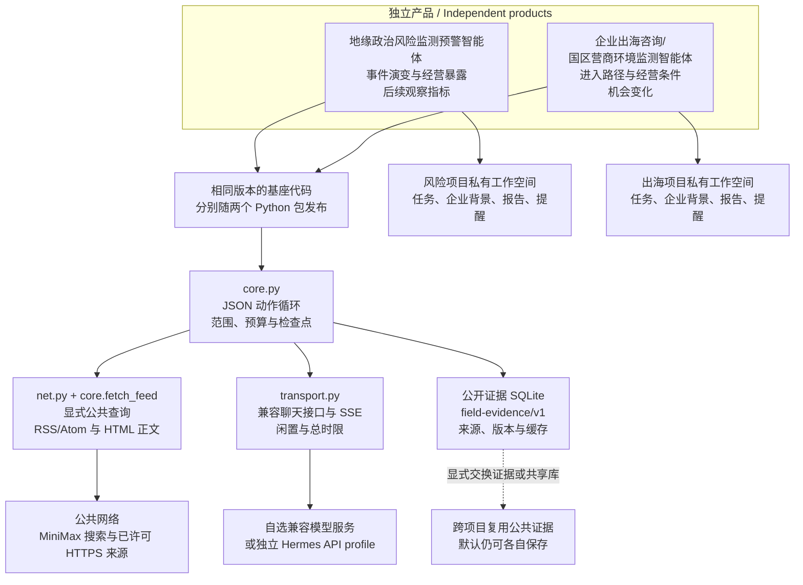

# 企业出海咨询/国区营商环境监测智能体

给企业海外业务团队、咨询人员和国区研究者使用。输入产品、目标市场和经营约束，得到带来源的进入路径分析、待核实问题和后续行动建议。

[English](README.md) · [先试演示](#先跑通一个示例) · [公开样例与来源](examples/README.md) · [联网研究](docs/live-research.md) · [Windows 安装](docs/windows.md)

这是可自行部署的 **Alpha 项目**。离线演示无需模型密钥，使用虚构材料；真实研究需要另行配置模型和信息源。

## 先看工作界面



上图展示国区看板。报告、来源和任务记录可在工作空间查看；它不代表对任意企业完成了研究。先用下面的演示查看保存的结果，样例数据范围见[公开示例](examples/README.md)。

## 先跑通一个示例

下面为 macOS / Linux 命令。Windows 可直接使用 Python，无需 WSL；请看 [PowerShell 安装与使用说明](docs/windows.md)，包括模型设置、中文路径、保存恢复、导出和常见问题。自动检查覆盖三个系统的 Python 3.11–3.13，并单独验证 Windows 独立环境安装。

```bash
git clone https://github.com/workstonedai-collab/market-entry-agent.git
cd market-entry-agent
python3 -m venv .venv
source .venv/bin/activate
python -m pip install -e .
market-entry-agent demo
market-entry-agent serve
```

浏览器访问 http://127.0.0.1:8712 。先查看已保存报告、证据和工具记录，再输入自己的研究任务。示例无需密钥，不调用大模型；资料和分析均清楚标为虚构情景或规则演示。

报告会围绕企业当前的选择展开，解释方案取舍、需要满足的条件和验证顺序。自然表达的要求在首次写作时应用，来源页可查看最近获取和失败情况。详见[报告写作与案例验证](docs/report-quality.md)。

研究任务现在可保存子问题、原文摘录、假设和下一步，恢复后继续使用。可另行填写公开词范围，允许智能体在预算内组合后续检索。本机文本、表格与可选的 PDF 文本资料也可导入；PDF 需另配提取工具，不含 OCR。基础安装仍无新增运行依赖，详见[研究进展与取材说明](docs/research-state.md)。

新增三组真实历史事件案例：CBAM简化与两种进口责任安排、英国加入CPTPP与马来西亚经销验证、EUDR历史延期与木家具资料准备。每次明确选择一组，保留智能体直接生成的原稿和运行回执，按“读得顺、分析有依据、建议能执行”检查；企业条件为虚构，报告不作人工改写后冒充原稿。使用方法见[案例验证说明](docs/report-quality.md#用几组真实事件检查直接生成的原稿)。

## v0.11.0：把进入方案算清楚，再决定先验证什么

[正式版本与安装包](https://github.com/workstonedai-collab/market-entry-agent/releases/tag/v0.11.0)已发布。这个版本可以在同一个项目里比较交易责任、报价与关键前提，继续跟踪哪些新资料可能改变原来的选择。

例如，同一款产品采用两种进口安排，可以分别记录生产方、出口方、卖方、进口主体和客户，再填入各自的报价或测算假设。系统按相同币种、数量和单位比较贡献额及现金占用；未知项留空，每项数值保留依据，报价变化后可回看前后差异。贡献额尚未计入未列出的费用，不等于净利润；税率与交易责任需要你明确填写。详见[从进入方案到验证与测算](docs/decision-paths.md)。

接下来要查什么，也可以落到项目里：哪些前提会阻断推进，哪些最影响选择，需要谁取得什么资料。新资料会指向关联方案、阶段和已有决策，是否调整选择由你决定。继续提问时，来源陈述、假设、判断和拟议方案分别保存；按当前问题带入相关内容，保留相关的反对依据和你的决定记录。[研究记忆](docs/research-memory.md) · [研究进展与取材](docs/research-state.md)

需要接到自己的工具里时，可以启用默认只读的[本地 MCP 接口](docs/mcp.md)；允许创建或恢复任务须另行显式开启。规则适用与交易成本等问题可选[分别取材](docs/research-depth.md)，仍共用同一任务的时间和调用预算。公开检索只使用你明确允许的查询或词项，企业背景不拼入搜索词。

这个版本用 MiniMax 跑过 CBAM 历史材料与两条虚构交易路径，并验证了报价修改、重算、版本记录和报告重开。直接生成的原稿保留了一处费用差额表述错误，测算表可用于逐项核对；保存问题的恢复过程及具体限制见[案例验证说明](docs/report-quality.md#v0110-产品路径验收)。

## 项目背景与开放范围

<details>
<summary>使用场景、长期跟踪与联系作者</summary>

一个围绕企业实际情况做出海研究、并持续跟踪目标市场变化的智能体。告诉它你卖什么、打算去哪里、目前处在哪个阶段，以及预算、渠道和交付有哪些约束，它会检索公开信息，阅读相关材料，梳理市场进入路径、经营条件、值得验证的机会和需要补充的信息。

出海前要回答的问题很多：先做哪个市场，找经销商还是自建团队，产品能否进入，售后怎么安排，政策变化会不会改变原来的成本和计划。通用国别报告往往很难回答一家企业的具体问题。这个项目把企业背景放进研究任务，让报告尽量落到准入、渠道、订单、成本和执行条件上；材料不足时，直接列出下一步需要验证的问题。

它既可用于进入市场前的咨询研究，也可用于进入市场后的营商环境跟踪。新的贸易安排、投资规则、基础设施进展或产业政策，可能带来机会，也可能改变原来的经营前提。你可以围绕一个问题跑一次研究，也可以设置周期任务，保存来源和报告，持续积累对目标市场的判断。它适合企业海外业务团队、咨询机构和国区研究人员使用。

如果你不熟悉编程，可以把这个仓库交给自己的 Agent，让它按说明部署，先用演示熟悉操作，再接入模型、公开搜索和信息源。可以独立使用，也可以与[地缘政治风险监测预警智能体](https://github.com/workstonedai-collab/georisk-agent)共享公共证据。企业画像、任务和咨询报告保存在各自的私有工作空间。

**开放范围与交流：** 国区评分配方、分项权重、贡献计算与通用研究步骤已公开。部分进一步的研究方法、专用提示词和相关知识内容暂未开源。如有需要或希望进一步交流，欢迎[联系作者](https://github.com/workstonedai-collab)或提交[项目 Issue](https://github.com/workstonedai-collab/market-entry-agent/issues/new)；私人资料请勿直接发布在公开 Issue。

[English](README.md) · [公开示例](examples/README.md) · [联网使用](docs/live-research.md) · [Hermes 接入](docs/hermes.md) · [项目记忆与技能](docs/kernel.md) · [Windows 安装](docs/windows.md) · [部署](docs/deployment.md)


</details>

## 国区看板：从背景到行动

先选国家，再看哪些变化值得研究。新增看板覆盖 **215 个经济体的治理分项**，其中 **101 个有完整双源营商研究参考**。你可以查看六维治理、营商三支柱与十个主题，比较最多五个国区，核对来源和数据期次，再带着所选国家发起研究。

年度结构数据、近期公开事件和已保存的国区研究放在同一条使用路径里。企业出海研究可以展开宏观、行业、竞对与进入路径，并形成分阶段行动计划；地缘风险研究可以保留经营暴露、观察条件和下一步核查。报告与来源一并保存，支持重开和导出。

指数采用本项目的 **60% B-READY + 40% WGI** 研究拟合。只有治理数据的国区会单独标出，缺失不补零；不把事件自动折算成涨跌，也不输出混合口径国家排名。它是本项目的研究参考值，计算结果可复核；不代表官方综合指数或已校准的国区风险预测。数据为 B-READY 2025 与 WGI 2026 更新的 2025 年观测，快照为 2026-10-21。

[国区看板与计算说明](docs/country-dashboard.md) · [数据署名与许可](LICENSE-DATA.md)




## 一次研究怎样完成

从一个具体问题开始。模型在任务范围和预算内选择工具，读取材料后直接形成报告；来源、执行步骤和结果会留下记录。



周期执行需要单独启动 worker。模型每次选择需要使用的工具，报告按任务保存；本地提醒的确认只改变提醒状态。

<details>
<summary>展开查看：任务时序与技术路线</summary>

### 从提交到保存的时序

网页先返回任务 ID，研究在服务端执行。每个工具步骤完成后保存进度；关闭页面后可以回来查看。模型或网络失败时，可以显式恢复原任务。



模型接收到任务、企业背景和选取的证据；公开搜索只发送用户明确填写的查询，或在获准公开词范围内组合的查询。工具返回的网页内容按资料处理，不作为执行指令。

### 两个项目怎样共用基座

两个仓库各自安装、运行和发布，共用相同版本的基础代码及 `field-evidence/v1` 证据格式。需要跨项目复用时，可以显式交换公共证据包或选择同一公共证据数据库。



图中的共同基座是分别随两个项目发布的代码。企业背景、任务、报告和提醒仍保存在各自私有工作空间；资料会按用户配置发送给模型服务。

</details>

## 项目持续跟踪

市场进入很少能靠一份报告定下来。你可以在“项目持续跟踪”里保存产品、客户、阶段和经营约束，把候选市场与进入方式放在一起比较，再记下方案依赖的关键假设和下一步工作。企业情况改变后，旧方案会提示重新判断，原来的研究和选择理由仍然保留。

打开项目后，先填写“企业情况”，再添加“进入方案”。新保存的资料与某条假设匹配时，项目会提醒你查看关联方案和计划，判断是否需要调整。智能体可以提出建议计划，实际进度和决策由你记录；完成一项工作时，也能留下实际结果。

[操作说明与公开案例](docs/product-workflow.md) · [案例资料](examples/public-project-case.json)

## 接着同一个项目继续研究

给相关任务填写同一个项目 ID，可以在换个问法后召回旧报告，并保留你录入的项目资料。本次输入优先于旧资料，企业资料与历史分析有明确区分；来源仍须在本次运行读取后才能引用。

```bash
market-entry-agent memory-set fictional-research product "虚构演示：设备出口"
market-entry-agent demo --project fictional-research
market-entry-agent run examples/project-mission.json --engine demo
market-entry-agent skills
```

网页新增项目资料、技能选择和研究暂停/取消入口。长资料分段读取，旧工具结果保存在本地；模型请求有上下文字符预算，并保留调用、耗时和服务已报告用量。操作、隐私与恢复边界见[共用内核使用说明](docs/kernel.md)。Windows 在独立环境中通过相同模块入口使用。

## 接入真实研究

配置你自己的模型服务，导入有权使用的证据包，并以 `--engine model` 运行任务。可以使用独立 Hermes Profile 的兼容接口，详见 [Hermes 接入](docs/hermes.md)。模型模式会把本任务、企业背景、检索结果与相关历史摘要发送到你配置的服务；不会扫描其他项目或自动读取密钥。

当前公开版支持公开证据导入、RSS/Atom 来源刷新、显式公开关键词搜索，以及已注册或搜索发现的 HTML 网页抓取。信息源的国区与主题标签由操作者配置；来源陈述不会自动被标为已核实事实。

## 可以从这些问题开始

| 你的问题 | 任务需要的输入 | 希望得到的结果 |
|---|---|---|
| 越南和印度尼西亚，哪个更适合先验证需求？ | 产品、目标客户、进入阶段、渠道与交付约束 | 可比较的经营条件、差异依据和需要补充的需求证据 |
| 先找经销商，还是建立本地服务团队？ | 售后要求、计划投入、已有能力和目标市场 | 进入选项、前置条件、拟议阶段及完成信号 |
| 进入后还需要跟踪哪些营商环境变化？ | 已采用的进入方式、成本假设与关注主题 | 对经营前提或机会有影响的信息、后续观察条件与来源 |

这些是示例问题，不代表已有客户项目或选国结论。仓库中的[虚构任务](examples/mission.json)用于熟悉操作；[公共国区数据任务](examples/public-data-mission.json)读取真实公开统计。当前阶段需要什么证据，由具体产品、市场和企业条件决定。

## 公开的研究步骤

研究按“看宏观 → 看行业 → 看竞对 → 进入路径”展开，把国区背景逐步落实到具体产品和执行条件。进口规模、关税、认证、渠道或竞争份额，都要检查是否对应同一产品、地域和时期；材料不足时保留待验证问题。

`research_plan` 提供公开研究提纲；报告可以保存 `roadmap`，为拟议阶段记录目标、工作、交付物、依赖和完成信号。后续关注项可保存为 `watchpoints`，跟踪可能改变进入方案的条件。自定义任务可通过 `output_sections` 要求包含 `roadmap` 或 `watchpoints`；这些安排不代表已有合作或项目完成。

## 使用自己的研究说明

公开版包含通用角色说明、公开研究提纲和报告格式。部署者可通过 `AGENT_INSTRUCTIONS_FILE` 显式加载自己的 UTF-8 说明文件（最多 24KB），放在仓库之外。其内容会发送到所配置的模型，并保存在本地任务检查点中。恢复任务时沿用原检查点；需要应用新说明时建立新任务。[模型、搜索与数据边界](docs/live-research.md)。

## 可以持续做什么

- 研究：模型自主选工具，围绕任务收集和阅读证据，再保存成果。
- 记忆：以项目 ID 关联研究，回看私有项目资料、业务状态和相关历史报告。
- 监测：保存关注周期，由单独启动的 worker 持续执行。
- 交付：直接保存报告，导出 Markdown/JSON，产生待确认的本地提醒。
- 恢复：保留已完成步骤，模型或网络失败后继续未完成部分。

出海研究重点是企业条件、准入与渠道、经营成本、执行路径及机会变化；咨询判断可以转为后续持续关注任务。

## 两个项目怎样互通

与 [georisk-agent](https://github.com/workstonedai-collab/georisk-agent) 共用证据契约和相同版本的内核，各自独立安装、运行、发布。公共证据可以显式共享，企业资料、任务和报告保存在各自私有空间。详见 [共同底座](docs/shared-core.md)。

## 当前交付边界

当前为单操作员自托管 alpha，包含命令行、可操作网页、数据与模型接口、容器配置和自动化检查。GitHub 发布提供源码和版本，不等于已经托管一个全天候在线服务。当前不包含商业多租户、外部消息自动发送、完整实时覆盖或已校准国区指数。

## 让你的 Agent 帮你部署

把仓库链接和下面这段话交给你的 Agent：

> 请先阅读 README 和部署说明，在独立目录安装这个项目，运行离线演示并打开本地网页。演示通过后，带我配置我选择的模型服务和公开信息源；需要搜索时，单独让我填写允许发送的公开关键词。请不要读取其他项目的密钥或企业资料。最后帮我跑一个自己的任务，确认报告已保存并可以重新打开。


### 研究记忆可以接续到下一次提问

同一项目的来源陈述、假设、判断和拟议方案会分开保存，下一次提问按相关性带入，并保留相关的反对依据。操作者可以记录自己的决定、修订原因或移出旧记忆；恢复任务沿用原快照。本次输入始终优先，历史判断不会自动变成新的证据。详见[研究记忆与上下文](docs/research-memory.md)。

### 比较交易责任，再算这笔业务

分别记录生产方、出口方、卖方、进口主体和客户，用明确报价或假设计算同口径贡献额及现金占用。每项数值保留依据，缺项留空，报价修改后可回看前后差异。需要先验证的前提按阻断程度、影响与投入排序；新资料指向关联方案和既有决策，是否改变选择仍由你决定。详见[从进入方案到验证与测算](docs/decision-paths.md)。

### 接入自己的工具，按问题展开研究

可通过[本地 MCP 服务](docs/mcp.md)读取已有任务、报告和项目记录；显式允许后，客户端才能创建或恢复研究任务。也可连接自己配置的公共 MCP 搜索服务，只发送允许的公开词。[可选研究分支](docs/research-depth.md)让不同前提分别取材，进度随任务保存，共用原来的时间和调用预算。文档技能支持声明输入、输出与工具依赖，仍不执行脚本或扩大权限。


### 把资料带进来，把研究接着用

开始研究时，可以选择专题研究、事件与报道准备、利益观察，或出海项目的市场选择、交易评估、经营跟踪。需要办公资料时，可选 MarkItDown 导入本机 Word、Excel 和 PowerPoint；已保存的完整报告可通过本地 OfficeCLI 导出为可编辑 Word，不额外调用模型。配置方式、已支持的范围与限制见[办公资料与任务入口](docs/office-and-tasks.md)，采用了哪些项目见[集成取舍](docs/integration-references.md)。
