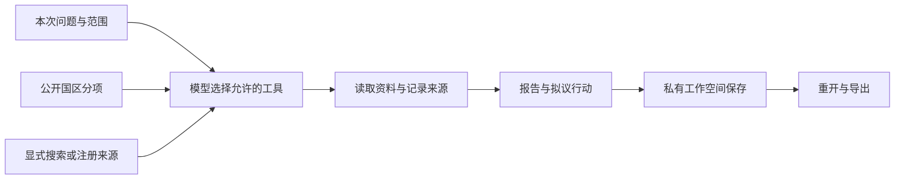

# 企业出海咨询/国区营商环境监测智能体

结合本次企业背景与问题，收集目标市场的公开资料、比较国区指标，保存研究报告与后续行动。

出海与风险研究需要把分散资料留在同一个任务里，知道每条信息来自哪里、何时取得，以及下一步还要查什么。这个项目提供可运行的通用智能体、国区看板和证据记录，让你围绕自己的问题研究、保存和继续跟进。

**开放范围与交流：** 公开版包含国区评分配方、分项权重和通用研究步骤。部分进一步的研究方法、专用提示词及相关知识内容暂未开源。如需了解这些能力、讨论使用方式或进一步交流，欢迎[联系作者](https://github.com/workstonedai-collab)。项目问题也可以通过 [Issue](https://github.com/workstonedai-collab/market-entry-agent/issues/new) 联系；涉及私人资料的内容请勿直接发布在公开 Issue。

[English](README.md) · [安装与部署](docs/deployment.md) · [数据来源](docs/country-dashboard.md)

## 先运行一次

需要 Python 3.11 或更新版本。无需密钥即可运行虚构资料演示和公开国区数据看板：

```bash
python -m pip install .
market-entry-agent --workspace ./workspace demo
market-entry-agent --workspace ./workspace serve
```

打开程序显示的本地地址。选择“国区数据与比较”，查找国家、查看来源分项并对照最多五个国区；选择“研究工作台”，查看保存的演示报告、工具步骤并导出 Markdown 或 JSON。

需要模型研究时，显式配置兼容模型服务；公开搜索只发送你填写的公开关键词。参考[联网配置](docs/live-research.md)、[Hermes 接入](docs/hermes.md)和[部署说明](docs/deployment.md)。

## 国区看板与公共数据

内置快照覆盖215个经济体的世界银行 WGI 2026更新（2025年观测）；其中101个还有 B-READY 2025的三支柱与十主题。保留来源、统计期、单元格位置和来源区间，缺失不填补。看板展示原始分项及公开研究参考值，保留公式、权重和分项贡献；不同覆盖的参考值不混合排名。[数据说明](docs/country-dashboard.md) · [数据署名与许可](LICENSE-DATA.md)。


## 从问题到保存结果



任务逐步保存。网络或模型失败后，可从同一任务恢复；报告直接保存。可选周期任务需要显式启动 worker，提醒保存在本地，不自动向外部发送消息。

## 可配置的研究说明

项目内置通用角色说明和输出格式。部署者可以使用 `AGENT_INSTRUCTIONS_FILE` 显式加载自己的本地说明文件。文件应放在仓库之外；其内容会发送给所配置的模型，并进入本地任务检查点。项目不自动读取个人记忆、凭据目录或其他私有知识库。[配置与隐私边界](docs/live-research.md)。

## 示例、测试与扩展

[虚构任务](examples/mission.json) · [公开分项查询示例](examples/public-data-mission.json) · [证据格式](docs/evidence.md) · [技术路线](docs/architecture.md) · [贡献说明](CONTRIBUTING.md)。

```bash
python -m unittest discover -s tests -v
python scripts/check_public_release.py
```

这是单操作员、自托管 alpha，提供独立源码、命令行和本地网页。每个使用者配置自己的模型、数据来源和工作空间。公共数据不等于实时事件覆盖，演示结果不等于真实业务结论。
