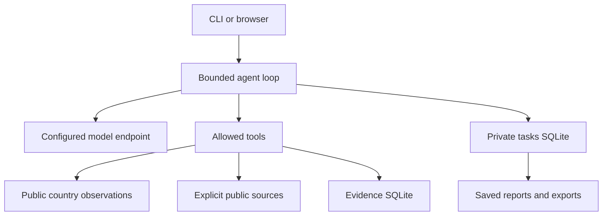

# Architecture

The two products ship independent Python packages with the same generic runtime and evidence format. `core.py` handles the JSON-action loop, read-before-citation, budgets, checkpoints and persisted reports. `app.py` serves the CLI and token-protected local workspace. `net.py` retrieves explicitly selected public queries and registered pages/feeds. `transport.py` provides bounded compatible chat streaming. `countries.py` reads attributed source observations. `research.py` contains generic output schemas and an editable task outline.

Product-specific default instructions are intentionally generic. Optional operator-owned instructions are loaded only from `AGENT_INSTRUCTIONS_FILE`; they are sent to the configured model and stored in private checkpoints. Keep that file outside source control. Specialized instructions and private knowledge are not bundled.

`shared-core.json` records the common file hashes. Run `scripts/check_core.py --peer /path/to/peer` when changing them. Country observations retain source units and periods and are used in the published research-reference calculation with explicit weights and coverage boundaries. Report validation checks structure and read evidence IDs, not independent factual review.

Project memory, bounded context, document skills, run controls and usage receipts: [shared kernel guide](kernel.md).
