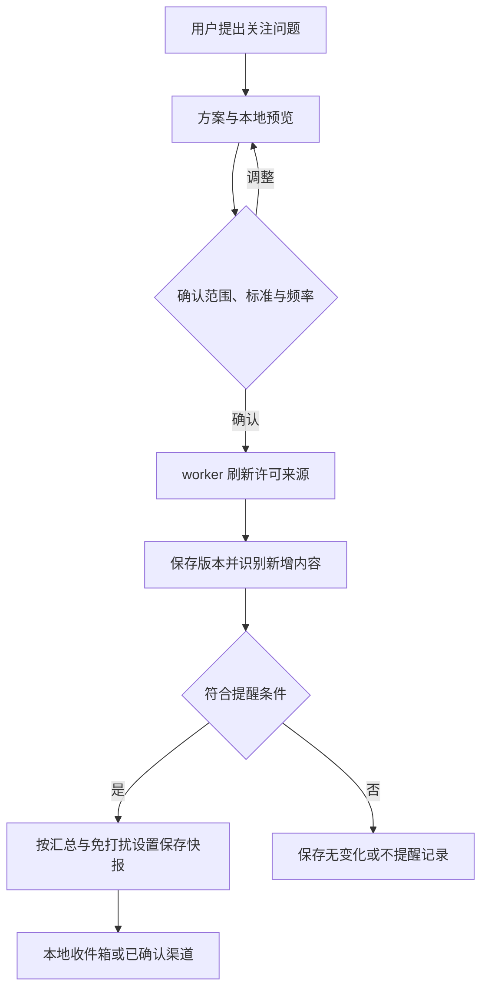

# 把材料、监测和经验接起来 / Continuous research

从“我的知识库”导入资料，在研究任务里选用；从“持续关注”保存监测方案，核对范围、标准和频率后启用；从“经验与技能”决定是否让项目积累可复用的研究步骤。三项设置都保存在私有工作空间。不同客户继续使用独立工作空间；这里的项目选择不等于商业多租户身份认证。

## 文件建库

1. 在页面顶部填写项目 ID，例如 `example-project`，进入“我的知识库”并创建一个有名称的知识库。
2. 选择文件，填写适用国区和主题标签。标签与任务匹配；原始发布日期未知时可以留空，不把导入日期当成发布日期。
3. 导入后查看“等待处理、正在解析、已入库或解析失败”。失败的导入可重试；进程中断时，活动租约到期后再重试同一已保存任务，原文件无需重传。
4. 先试查资料，再点“用于当前研究”；也可以在工作台多选本项目知识库。模型模式只将选中范围的相关片段交给你配置的模型。离线 demo 仍只读取虚构示例，不冒充对上传文件的模型分析。
5. 文件更新时选择“替换文件”。新任务使用新版本，已初始化的任务保留原版本。可以下载各版本原件；删除会移除所有版本原件及可检索片段，并撤销旧任务继续读取该文件的权限。

支持 UTF-8 TXT/MD/CSV/TSV；PDF 和 DOCX/XLSX/PPTX 使用原有可选适配器，见[办公资料](office-and-tasks.md)。每份最多 8 MB、100 个解析部分和 1500 个检索片段。PDF 仅处理前 40 页，扫描件不自动 OCR；Office 保留转换后文字位置，不能声称已精确还原页码、单元格或幻灯片。CSV/TSV 保留行范围。解析限制随证据传入报告。

原件、版本元数据和片段保存在工作空间的 `knowledge/` 与私有任务数据库中，不进入共享公共证据库。来源使用 `document://` 标识，不要求为本地文件编造一个公共网址。SHA256 和出处位置随引用保存；Markdown/JSON 导出保留出处。删除文件不会自动删除已经保存的报告、研究摘录、学习所得技能或用户自行导出的副本，这些有各自的保留语义。

检索使用 SQLite FTS5/BM25 和中文双字词重叠；没有 FTS5 时回退到本地词项匹配。索引可重建。当前没有向量数据库、自动实体关系抽取或 OCR 服务依赖。集合与项目的限制在服务端的搜索、读取和原件导出环节执行。文件正文是材料，不能授予工具权限；私有内容不会自动变成公开搜索词。

## 用户确认后监测

监测方案沿用工作台当前的研究问题、国区、标签、知识库、公开查询及任务预算。按顺序操作：

1. 填写监测目的：事件风险、长期议题或经营条件与机会。
2. 写明哪些变化值得提醒、哪些只作背景，并设置明确匹配词、排除词及可刷新的已登记来源。
3. 分别设置检查间隔和汇总间隔、时区与免打扰时段。默认时区使用 `UTC+08:00` 这类固定偏移，原生 Windows 无需额外时区包；使用 IANA 地区时区需要系统数据或可选 `tzdata`。间隔为 1 分钟至 7 天，汇总间隔不得短于检查间隔。
4. 选择首次运行只建立基线，或也提醒已有匹配资料。来源为空且没有公开查询时，只观察本地资料的新增版本。
5. 保存并预览。预览显示完整范围、标准、频率、资料范围和接收位置，以及已有资料中的匹配项；不会刷新来源、调用模型或发送消息。
6. 点击“确认这些设置并启用”，再单独启动 `market-entry-agent worker`。创建方案不会安装操作系统服务。机器休眠或 worker 停止时，不能声称仍在监测。

确认绑定完整配置版本与哈希。编辑方案后回到待确认状态；修改来源配置或外部接收目标也会要求重新确认。暂停后可载入设置、预览并确认恢复；无需每次正常检查都向用户确认。旧版 `schedule` 命令继续兼容，操作员直接执行该命令属于显式创建旧式定时研究，不具备新监测方案的筛选流程。

**规则模式**只执行用户明确的来源、国区/标签、匹配词、排除词和最低来源站点/文档数条件，不假装理解自由文字标准。相同标题按组计数，站点数量不等于独立核实；不进行未经验证的语义聚类。规则快报展示来源摘录及其性质。**模型模式**在有新材料时运行有预算的研究任务，读取来源后根据文字标准返回 `monitor_decision` 的 `notify` 与 `reason`；即使决定不提醒，报告也会保存。单批最多 40 条新证据，未处理部分留给后续检查。模型不得将资料中的指令当成监测设置。



检查按确认的周期刷新网页和公开查询，不被普通研究的缓存周期覆盖。来源正文的内容指纹用于去重，网址、抓取时间和建议改写不使事实自动变新。规则模式只识别标准化正文的实质差异；更复杂的语义判断交给模型，仍不保证全量覆盖或事实正确。

每次计划执行有持久回执与执行租约，避免并发领取。失败与“没有变化”分开记录，失败限次间隔退避；过期计划只补一次当前检查，不批量补发旧消息。已生成报告在进程中断后可复用。分析任务失败会暂停监测：先从研究工作台恢复原任务，再在监测记录中选择重试原检查，不静默创建第二个收费任务。普通旧式定时任务也补充了失败记录与退避。

## 可选 Hermes / 飞书发送

默认只保存到本地快报收件箱。外部发送仅通过操作员显式配置的 Hermes CLI，复用 Hermes 已安装的渠道；本产品不自动读取个人 Hermes 配置或凭据，也不安装网关。

在仓库之外创建一个 UTF-8 JSON 文件，并将它的绝对路径设置为 `AGENT_MONITOR_DELIVERY_CONFIG`。配置名供界面选择；路径和接收目标不进入公开仓库：

```json
{
  "team-brief": {
    "label": "自己核对过的接收位置",
    "target": "REPLACE_WITH_YOUR_HERMES_TARGET",
    "executable": "REPLACE_WITH_ABSOLUTE_HERMES_EXECUTABLE"
  }
}
```

选择 Hermes 发送后，预览显示目标标签并绑定实际配置指纹。更换接收者或可执行程序需要重新确认。选用私有知识库或使用模型研判发送到外部时，还必须勾选允许将项目背景、记忆与选中材料用于外部快报；未允许时私有文档不能进入规则快报，模型快报也不能启用外部发送。固定执行参数为 `hermes send --to TARGET --json SAVED_TEXT`，不执行模型生成的命令。

快报先持久保存，再领取发送权，回执记录消息 ID。进程在发出消息后失去确认、超时或返回结果没有消息 ID 时保留 `unknown`，不自动重发。尚未开始发送的持久 `pending` 快报可在后续 worker 中继续交付。`sent` 只表示适配器取得了消息 ID，不代表收件人已读；未确认结果需要操作员对照目标渠道处理。本轮公开回归使用模拟 Hermes 回执，不声称已经验证某个用户的实际账号、飞书群或长期网关运行。

## 从经验生成私有技能

在“经验与技能”中按项目选择：

- **关闭**：默认行为，不额外创建候选或调用模型。
- **本地整理**：从已完成任务的有效工具路径和显式纠正中生成文档类技能，不复制来源正文、客户名称或整篇报告，不增加模型调用。它是确定性整理，不声称进行了语义反思。
- **模型提炼**：用已配置模型进一步提炼一般步骤与注意事项。每个学习任务最多请求一次、40 秒，项目按 UTC 日设置 1–20 次独立调用上限；调用开始就计入上限，失败或中断不静默重试。

启用后，报告保存会排入学习任务，由同一个 worker 处理，不阻塞原报告。也可以选择本项目已完成任务并写一条“以后应该怎样做”的纠正，立即整理候选。默认由用户选择版本启用；可以显式允许本项目的新文档类技能自动启用。技能声明的工具必须已经存在，文档不能增加工具权限、修改监测配置或突破调用预算。

每个版本保留来源任务和生成记录。启用旧版即回退；停用会从新任务目录移除，已初始化的任务继续使用原来的技能快照。导出为常见 `SKILL.md` 格式供 Hermes 或其他兼容宿主使用，但不会自动安装到个人技能目录或发布到 GitHub。技能文本可以包含用户自己录入的纠正，因此公开分享前仍应检查其内容。

这套学习改善的是项目记忆与可复用流程，不更新基础模型权重。任务成功保存也不等于其中的事实与判断已经被独立核实。

## CLI 与 HTTP

浏览器和命令行使用相同的管理接口。`--data` 读取显式 JSON 命令文件；示例均为可公开的虚构练习材料。PowerShell 可用 `python -m market_entry_agent` 替代 `market-entry-agent`，不依赖 shell 激活：

```text
market-entry-agent manage knowledge create --project example-project --data examples/knowledge-create.json
market-entry-agent manage knowledge list --project example-project
```

将返回的集合 ID 填入 `examples/knowledge-metadata.json` 的 `collection_id` 副本，再执行：

```text
market-entry-agent manage knowledge import --project example-project --data YOUR_PRIVATE_IMPORT_JSON --file examples/knowledge-note.txt
market-entry-agent manage knowledge list --project example-project
market-entry-agent manage knowledge rebuild --project example-project
market-entry-agent manage monitors save --project example-project --data examples/monitor-config.json
```

保存监测后，将返回的 `id` 放入私有 JSON：`{"id":"RETURNED_MONITOR_ID"}`，执行 `manage monitors preview --project example-project --data YOUR_PREVIEW_JSON`。核对后，另建含 `id` 和本次返回 `hash` 的 JSON，执行 `manage monitors confirm --project example-project --data YOUR_CONFIRM_JSON`，随后运行 `worker --once` 或长期运行 `worker`。

学习策略：`manage learning policy --project example-project --data examples/learning-policy.json`。查看结果：`manage learning status --project example-project`。反馈命令文件包含 `run_id` 和 `lesson`，用 `manage learning feedback`；启用/回退用 `manage learning activate`，命令文件包含 `name` 和 `version`，省略 `version` 为停用。导出用 `manage learning export --data YOUR_SKILL_VERSION_JSON --project example-project --output SKILL.md`，目标文件必须尚不存在。

HTTP 使用 `/api/knowledge/{create,list,import,retry,search,read,original,delete,rebuild}`、`/api/monitors/{save,list,preview,confirm,control,check,history,retry,acknowledge}`、`/api/learning/{policy,status,feedback,process,activate,export}`。POST 均带 `project_id` 和相应 CLI JSON 字段；上传使用 `filename`、`metadata`、`collection_id` 和 `content_base64`。所有变更使用 POST；读取可使用 GET 查询参数，`collection_ids` 以逗号分隔。原件及技能导出返回字节，其余返回 JSON。异步导入和学习从列表查看最终状态。原有 Host、Origin、访问令牌和两工作线程限制继续生效。

## 验证与后续扩展 / Verification and limits

`python -m unittest discover -s tests -v` 覆盖集合范围、中文检索、重复导入、版本冻结、删除撤权、报告取材与引用、监测确认/修改、去重/静默、失败恢复、免打扰、发送回执、学习额度和技能版本回退。`python scripts/verify_lifecycle.py` 从已安装包的 CLI 走建库、报告保存重开、监测确认及经验生成。模型分支采用明确标记的脚本替身；这不证明某个供应商的文字质量。跨平台 CI 继续验证 Python 3.11–3.13、Windows PowerShell、容器及可选 Office 适配器。

The base runtime remains Python-standard-library only. Private collections, confirmed watches and opt-in procedural learning are additive; existing reports, product paths, public country dashboards and MCP interfaces remain available. A running worker is required for unattended work. No hosted multi-tenant service, model-weight training, vector/graph backend, guaranteed source coverage or delivery to a real account is implied by the automated tests. See [design references](integration-references.md).
