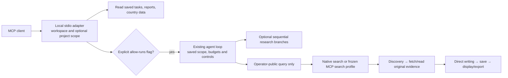

# MCP 接入 / MCP integration

## 把本项目接到自己的 MCP 客户端

```sh
market-entry-agent --workspace ./private-work mcp-serve --project equipment-asean
```

这是显式启动的本地 stdio 服务，默认只读。可以查看国区覆盖与比较、任务状态、已保存报告、研究工作表及项目记录。大结果按 `offset/limit` 分页读取，每页最多 6000 字符。

Add this to your own MCP client's configuration (replace Python and workspace paths with local absolute paths):

```json
{"mcpServers":{"market-entry-agent":{"command":"/absolute/path/to/python","args":["-m","market_entry_agent","--workspace","/absolute/path/to/private-work","mcp-serve","--project","equipment-asean"]}}}
```

Windows uses the absolute venv `Scripts\python.exe` path and a local Windows workspace path. The process uses UTF-8 newline-delimited JSON-RPC. No HTTP listener or public MCP endpoint is started. The adapter supports the core tools/lifecycle protocol versions 2024-11-05 through 2025-11-25; it does not advertise resources, prompts, OAuth, sampling or task-augmented execution.

## 允许创建或恢复研究任务

Only an explicit startup flag enables task mutation:

```sh
market-entry-agent --workspace ./private-work mcp-serve --project equipment-asean --allow-runs
```

`run_create` requires `client_key`, `mission` and `engine` (`demo` or `model`). The key deduplicates repeated create requests; different input with the same key is rejected. It returns a saved run ID promptly. Use `run_status` to check progress, `run_report`/`research_read` for saved content and `run_resume` for an explicit retry. A busy adapter returns a durable queued task; resume it when a worker is free. At most two workers run in one adapter process. `run_control` pauses/cancels at the same safe boundary as the existing UI.

Model mode uses the existing configured model and can incur provider charges. Mission country/topic scope, call/step/time budgets, frozen instructions, checkpoint recovery and protected operator business records continue to apply. The adapter grants no new ability to send messages, publish content, run model-authored code or change operator decisions.

本地工作空间是客户隔离边界；`--project` 进一步限制这个客户端可读取或操作的项目。连接 MCP 客户端意味着该客户端可以取得所开放的私有记录。请只连接你信任的客户端，并为不同客户使用不同工作空间。进程停止后未完成任务仍保留检查点，可在下次显式启动服务后恢复；服务不会自行常驻或安装后台任务。

## 使用外部 MCP 搜索

This is separate from exposing this project as an MCP server. The optional outbound integration invokes one operator-selected stdio public-search tool; the model cannot select an executable, tool name or arbitrary arguments. It sends only an explicitly public query and fixed configured arguments, with a bounded timeout and result size.

Set `AGENT_MCP_CONFIG` to a private JSON file outside the repository:

```json
{"public_search_profiles":{"public-research":{"command":["/absolute/path/to/search-server"],"tool":"search","query_field":"query","arguments":{"limit":3},"env_allowlist":["MY_SEARCH_TOKEN"],"allowed_hosts":["www.gov.uk"]}}}
```

The executable must be an existing absolute file. `arguments` are fixed, bounded and cannot contain `query_field`; optional credentials are taken only from named environment variables. Required process environment (PATH, system/temp/locale values) is preserved, while unrelated model keys and private context are not forwarded. Configuration and credentials remain operator-owned; do not commit them.

Then add `"mcp_search":"public-research"` to a mission, or enter the profile name in the browser's optional source settings. Use either explicit `search_queries` or indexed `public_search` terms as before. A run freezes its selected profile and records a hash in usage receipts; it does not send executable paths/configuration into model context. Editing the local config affects new runs, while resume keeps the original profile. Service credential environment may be renewed independently.

The selected server must implement `initialize`, `tools/list`, and `tools/call`, returning a JSON object with `results: [{title,url,body,published_at?}]` in `structuredContent` or a JSON text content block. Only HTTPS results from the profile's exact `allowed_hosts` and optional mission `search_domains` are accepted. Returned publication dates stay unverified; results are discovery snippets and cannot support a final citation until original page evidence is fetched and read.

外部服务程序是你明确配置并信任的程序；本项目对查询内容、返回来源和调用期限做限制，不是这个程序的操作系统沙箱，也不保证其自身的网络行为。基础安装无需 MCP SDK 或新依赖；第三方服务由操作者另行安装。自动测试使用真实协议子进程验证接线、超时和数据边界，不代表已替你部署或验收任意第三方服务。

Protocol references: [MCP stdio transport](https://modelcontextprotocol.io/specification/2025-11-25/basic/transports), [MCP tools and execution errors](https://modelcontextprotocol.io/specification/2025-11-25/server/tools).

## 接入路线 / Integration route


